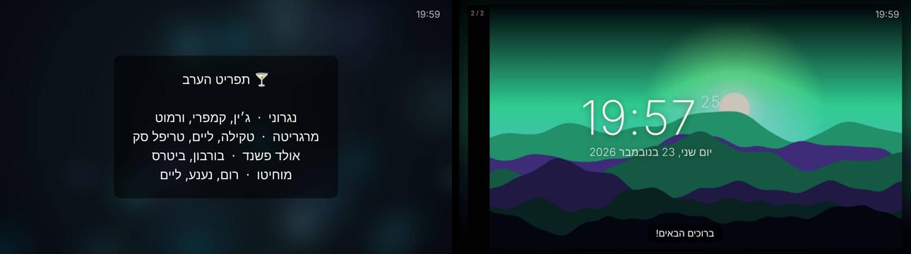

# Tizen TV Screensaver

A Chromecast-style ambient screen for Samsung Smart TVs (Tizen). It shows beautiful photos, famous paintings or live generative art with a clock, keeps the screen awake, protects against burn-in, and lets you cast photos or text (like a party menu) to the TV from Telegram.


## Features

- **Four background modes**
  - `photos`: curated landscape photography from Wikimedia Commons Featured Pictures, or Unsplash if you add a key
  - `art`: public-domain paintings from the Art Institute of Chicago
  - `mix`: photos and paintings alternating (default)
  - `live`: six animated generative artworks drawn in code (silk flow, aurora, bokeh, sunset ridges, ribbons, galaxy). Works offline.
- **Clock and date** (Hebrew date by default) with photo and artist credits
- **Keeps the screen on** with `tizen.power.request("SCREEN", "SCREEN_NORMAL")`
- **Burn-in protection**: the clock and credits drift slowly, backgrounds rotate, shared content shifts by a few pixels every minute
- **Telegram bot**: send a photo, video or text to your bot and it appears on the TV. No server needed, the TV polls Telegram directly.
- **Remote control support** and automatic fallback to live art when there is no internet



## Install

### 1. Enable Developer Mode on the TV

1. Open **Apps** on the TV.
2. Type `12345` with the remote. On remotes without number keys, press the **123** button to open an on-screen keypad. On some newer models the option is under **Apps > App Settings**.
3. Turn Developer mode **On**, enter your computer's IP address, and restart the TV by holding the power button for 2 seconds.

### 2. Set up the tools

1. Install [VS Code](https://code.visualstudio.com/) and the **Tizen Extension** and **Tizen TV** extensions.
2. Let the extension install the Tizen SDK, plus **Samsung TV Extensions** and **Samsung Certificate Extension** (version 2.0.73 or later) from the Package Manager.
3. Find the TV's IP address on the TV under **Settings > General > Network > Network Status > IP Settings**. In **Device Manager**, add the TV by that address (port `26101`). The computer and the TV must be on the same network.
4. In **Certificate Manager**, create a **Samsung** certificate for **TV**. Add your TV's DUID, which you can get with:
   ```
   sdb connect <TV_IP>
   sdb shell 0 getduid
   ```
   On Windows, if `sdb` is not recognized, it is installed but not on your `PATH`. Find it and run it by its full path:
   ```powershell
   $sdb = (Get-ChildItem C:\, $env:USERPROFILE -Filter sdb.exe -Recurse -Depth 5 -ErrorAction SilentlyContinue | Select-Object -First 1).FullName
   & $sdb connect <TV_IP>
   & $sdb shell 0 getduid
   ```

### 3. Configure

```
cp config.example.js config.js
```

Edit `config.js`. Every field is optional:

| Setting | Description |
| --- | --- |
| `BOT_TOKEN` | Telegram bot token from [@BotFather](https://t.me/BotFather) |
| `ALLOWED_CHAT_IDS` | Chat IDs allowed to send content. Leave empty and use `/pair` instead. |
| `MODE` | Starting mode: `mix`, `photos`, `art` or `live` |
| `PHOTO_MINUTES` | How long each photo or painting stays on screen, in minutes. Default `1`. |
| `UNSPLASH_KEY` | Unsplash Access Key from [unsplash.com/developers](https://unsplash.com/developers) |
| `UNSPLASH_QUERY` | Unsplash search query, default `landscape nature` |

`config.js` is in `.gitignore`, so your keys are never committed.

### 4. Build and run

Open the folder in VS Code. In the Tizen panel, check that the project, device and certificate are selected under **Active Targets**, then click **Build Project** and **Run Project**.

To open it later, find **TV Screensaver** under **Apps** on the TV. To pin it to the Home bar, highlight it, long-press the center button and choose **Add to Home**.

To update the app after changing the code, run **Build Project** and **Run Project** again.

## Install with an AI assistant

Not a developer? Copy this prompt into the AI assistant you like (Claude, ChatGPT, Gemini or another) and it will walk you through the whole installation.

```text
I want to install an open-source screensaver app on my Samsung Smart TV.
The project and its instructions are here: https://github.com/sbt94/tizen-tv-screensaver
If you can open links, read the README there first.

Guide me through the installation as a patient technical helper:
- First ask me for my TV model (it is under Settings > Support > About This TV) and whether my
  computer runs Windows or Mac.
- Give me ONE step at a time and wait until I confirm it worked, or until I send you the error or
  a screenshot, before you move on.
- Use simple language and tell me exactly where to click.

The steps, in order:
1. Download the project from GitHub (Code > Download ZIP) and extract it.
2. Turn on Developer Mode on the TV: open Apps, type 12345 with the remote (on remotes without
   number keys, the 123 button opens a keypad; on newer models it is under Apps > App Settings),
   switch it On, enter my computer's IP address, then restart the TV by holding the power
   button for 2 seconds.
3. Install VS Code with the "Tizen Extension" and "Tizen TV" extensions, and let them install the
   Tizen SDK, Samsung TV Extensions and Samsung Certificate Extension.
4. Find the TV's IP address (Settings > General > Network > Network Status > IP Settings) and add
   the TV in the extension's Device Manager with port 26101.
5. Create a Samsung certificate for TV in Certificate Manager and add the TV's DUID to it. I can
   get the DUID with "sdb connect <TV_IP>" and then "sdb shell 0 getduid". On Windows, if sdb is
   not recognized, help me find sdb.exe and run it by its full path.
6. Copy config.example.js to config.js. Optional: help me create a Telegram bot with @BotFather
   and put its token in config.js, so I can send photos and text to the TV.
7. In the Tizen panel of VS Code click Build Project, then Run Project.
8. Pair my phone: send /pair with the 6-digit code shown on the TV to my bot.

Important:
- Never ask me to paste my bot token, API keys or passwords into this chat. Tell me where to put
  them in config.js myself.
- If Build works but Run fails, the connection to the TV has usually dropped. Have me run
  "sdb connect <TV_IP>" and try again.
- If something does not match what I see on my screen, ask me for a screenshot instead of guessing.
```

## Remote control

| Button | Screensaver | While showing Telegram content |
| --- | --- | --- |
| ◀ ▶ | Previous / next photo or artwork | Previous / next item |
| ▲ ▼ | Brightness (live mode) | Brightness |
| OK | Show / hide seconds | |
| Green | Switch mode | |
| Play/Pause | Pause auto-rotation | Pause auto-rotation |
| Red / Info | Help and Telegram pairing code | Help |
| Back | Exit | Back to clock |

## Telegram

1. Create a bot with [@BotFather](https://t.me/BotFather) and put the token in `config.js`.
2. The TV shows a 6-digit pairing code under the clock. Send `/pair <code>` to your bot. Pairing is saved on the TV. To pair another phone, press the red button on the remote: it shows a code and accepts new pairings for 5 minutes.
3. Send:
   - **A photo**: shown full screen, with its caption. Send it as a file for full quality.
   - **A video or GIF** (up to 20 MB, a Telegram Bot API limit): plays full screen, muted by default. A single video loops.
   - **Text**: shown as a large card, great for a menu.
   - **Several items**: they rotate every 20 seconds. Videos play to the end before moving on.

| Command | Action |
| --- | --- |
| `/clock` | Back to the screensaver and clear shared items |
| `/show` | Show the shared items again |
| `/next` | Next item |
| `/undo` | Remove the last item |
| `/sound` `/mute` | Turn video sound on or off |
| `/mix` `/photos` `/art` `/live` | Switch background mode |
| `/help` | List commands |

Shared content returns to the clock automatically after 8 hours.

## Security notes

- `config.js` holds your bot token and API key and is ignored by git. The built `.wgt` package contains it too, so do not share your build or upload it anywhere.
- Only paired chats can put content on the TV. The pairing code changes after 5 wrong guesses, each chat gets 5 tries, and once a phone is paired, new pairings need the red button on the remote.
- Anyone with your bot token can control the bot. If it leaks, send `/revoke` to [@BotFather](https://t.me/BotFather) and update `config.js`.

## Troubleshooting

- **Build succeeds but Run Project fails**: the connection to the TV usually dropped because the TV was turned off or went to standby. The IP address can stay the same while the connection is gone. Run `sdb connect <TV_IP>`, check that `sdb devices` lists the TV as `device`, then run the project again. If it still fails, make sure Developer mode is still On in the TV's Apps screen.
- **Install fails with a certificate error**: the TV's DUID is missing from the certificate. Connect the TV first, then recreate the certificate.
- **The screen still dims**: turn off Eco / energy saving and auto power off in the TV settings.
- **No photos, only live art**: no internet connection. The app retries every 5 minutes.
- **The bot does not respond**: the app must be running on the TV. If the TV shows a webhook message, open `https://api.telegram.org/bot<TOKEN>/deleteWebhook`.
- **Animation stutters on older TVs**: lower `ART_FPS` in `index.html` to 20.

## Credits

- Photos: [Wikimedia Commons](https://commons.wikimedia.org/wiki/Commons:Featured_pictures) Featured Pictures and [Unsplash](https://unsplash.com). Photographer credit is shown on screen.
- Paintings: [Art Institute of Chicago API](https://api.artic.edu/docs/), public-domain works only.

## License

[MIT](LICENSE)
