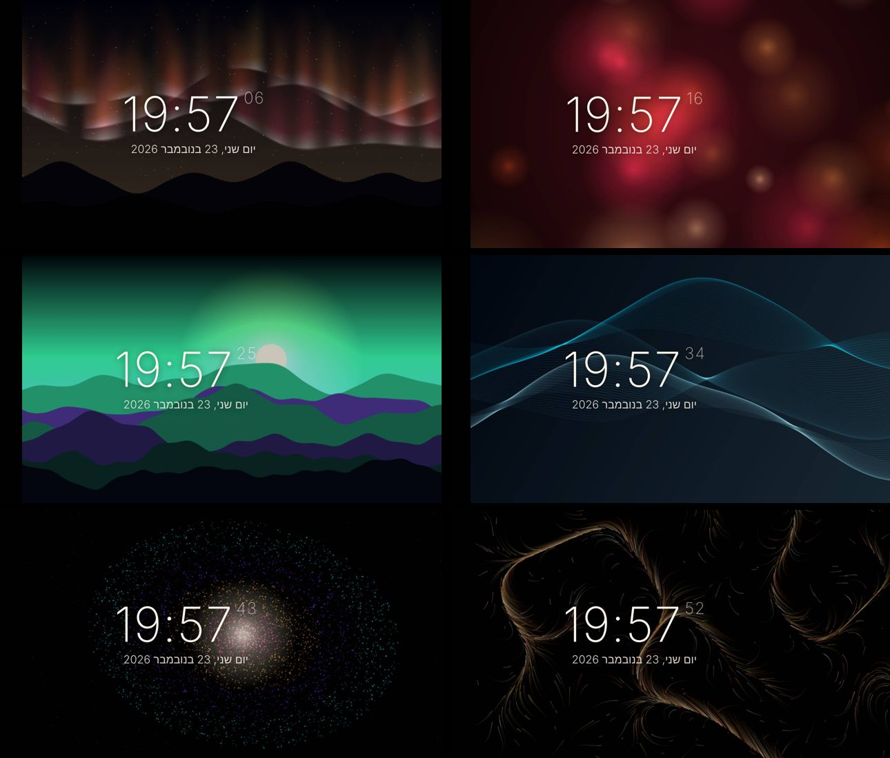
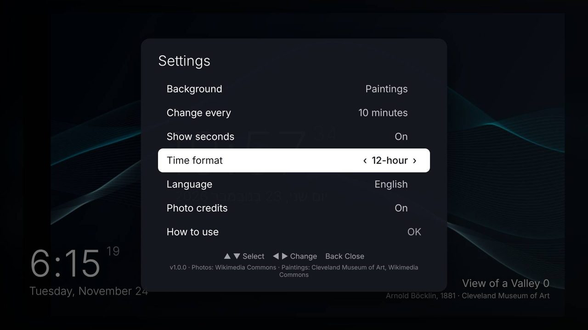

# Tizen TV Screensaver: store edition

This branch is the version being prepared for the Samsung TV app store. It needs no setup files, keys or accounts: install it and it works, and every option is changed with the remote.

For the full version with Telegram casting, see the [`main` branch](https://github.com/sbt94/tizen-tv-screensaver).

## What it does

- **Four backgrounds**: photos and paintings together, photos only (Wikimedia Commons Featured Pictures), paintings only (Cleveland Museum of Art open access and Wikimedia Commons), or six animated artworks drawn in code that work offline.
- **Clock and date** in English or Hebrew, 24-hour or 12-hour, with or without seconds.
- **Settings screen** opened with OK. Choices are saved on the TV.
- **How to use** screen, reached from the settings or with the red or Info button.
- **Keeps the screen on** and protects it from burn-in: the clock drifts, pictures rotate.
- **Falls back to live art** when there is no internet and retries every 5 minutes.

## Remote control

| Button | Action |
| --- | --- |
| OK | Open settings |
| ◀ ▶ | Previous or next picture |
| ▲ ▼ | Brightness |
| Play/Pause | Keep the current picture on screen |
| Red / Info | How to use |
| Back | Exit (asks first) |

## Differences from `main`

| | `main` | `store-edition` |
| --- | --- | --- |
| Telegram casting | Yes | No (needs a shared backend first) |
| Setup | `config.js` with your own keys | None |
| Options | Edited in a file | Settings screen on the TV |
| Photos | Unsplash (with your key) or Wikimedia | Wikimedia |
| Language | Hebrew | English and Hebrew |
| App ID | `SbtSaver01.TVScreensaver` | `SbtSaverSt.TVScreensaver` (both can be installed side by side) |

## Try it on your TV

Build and run it the same way as the `main` branch (see its README), without the `config.js` step.

## Status

Not submitted yet. See [STORE.md](STORE.md) for what is done and what is left.

## Credits

- Photos: [Wikimedia Commons](https://commons.wikimedia.org/wiki/Commons:Featured_pictures) Featured Pictures. The photographer is credited on screen.
- Paintings: [Cleveland Museum of Art Open Access API](https://openaccess-api.clevelandart.org/) (CC0) and Wikimedia Commons.

## License

[MIT](LICENSE)
